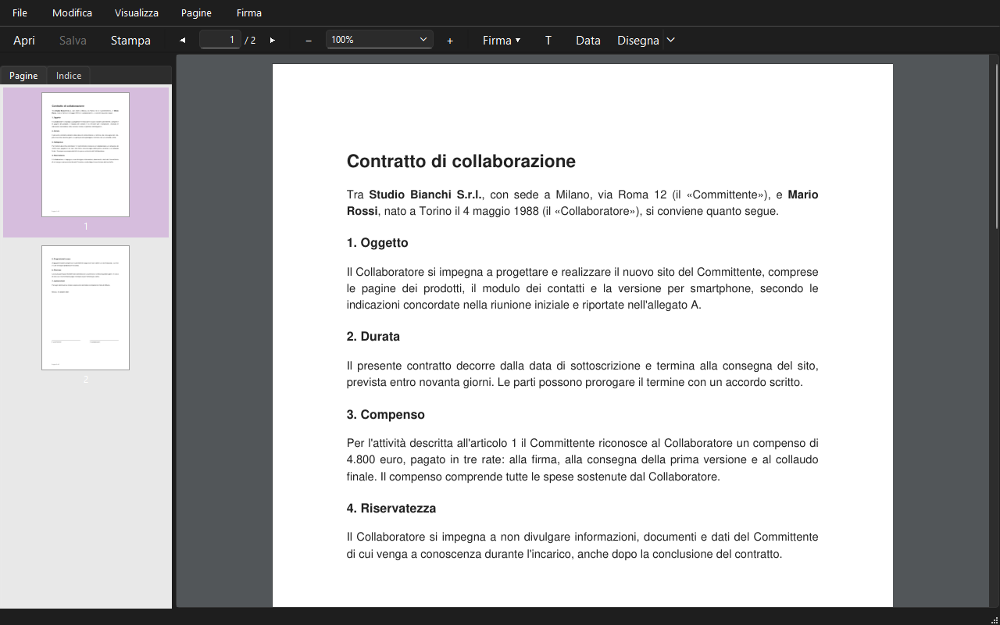
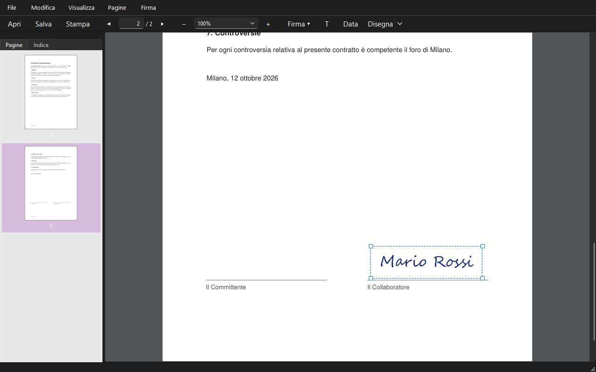
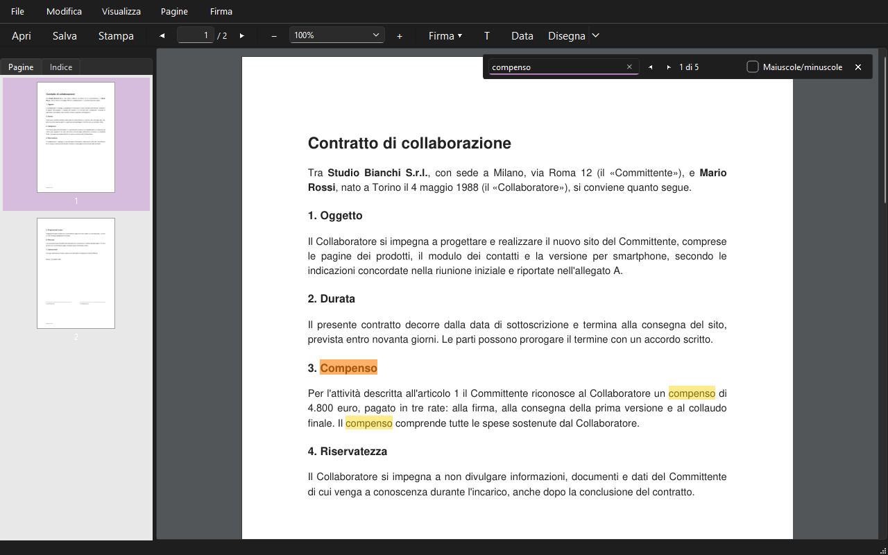

# PieDF

Lettore PDF leggero e portatile per Windows 10 e 11. Apri, leggi, cerca e stampa i tuoi PDF, compila i moduli e firma i documenti con la tua firma, senza installare niente. Gratuito e libero.

> **English** — PieDF is a lightweight, portable PDF reader for Windows 10/11. It opens, searches and prints PDFs, fills in PDF forms, lets you sign documents with a drawn, typed or image signature, adds editable text boxes and freehand drawings, and reorganizes pages (reorder, rotate, insert, extract, delete). No installer: unzip and run `PieDF.exe`; to uninstall, delete the folder. Free software under the [AGPL-3.0](LICENSE). Download: [Releases](https://github.com/dellaluca/PieDF/releases) · [Code signing policy](#code-signing-policy)

## Cosa fa

- **Leggere**: scorrimento continuo, zoom, pannello laterale con le miniature delle pagine e l'indice del documento, link cliccabili. Riapre ogni file alla pagina dove l'avevi lasciato.
- **Cercare e copiare**: trova una parola in tutto il documento e seleziona il testo per copiarlo.
- **Firmare**: crea la tua firma (o le iniziali) disegnandola, scrivendola in corsivo o da una foto, e mettila dove serve. Le firme restano salvate per le volte successive.
- **Compilare i moduli**: caselle di testo, spunte e scelte dei moduli PDF.
- **Scrivere e disegnare**: aggiungi caselle di testo, la data, tratti a mano libera ed evidenziazioni, modificabili anche dopo il salvataggio.
- **Organizzare le pagine**: riordina, ruota, elimina pagine, inserisci pagine da altri PDF ed estraine una parte in un file nuovo.
- **Stampare** quello che vedi, firme comprese.

## Scaricare e usare

1. Scarica lo zip `PieDF-<versione>-win64.zip` dalle [Release](https://github.com/dellaluca/PieDF/releases) e scompattalo dove vuoi: Documenti, Desktop, una chiavetta USB.
2. Avvia `PieDF\PieDF.exe`. Non c'è niente da installare.

Le tue firme e le impostazioni stanno nella cartella `PieDF\data`: copiando la cartella di PieDF te le porti dietro. Se PieDF è in una cartella dove non può scrivere, le salva in `%APPDATA%\PieDF`.

**Aprire i PDF con PieDF**: tasto destro su un PDF → *Apri con* → *Scegli un'altra app* → *Cerca un'altra app in questo PC* e scegli `PieDF.exe`. Spuntando *Usa sempre quest'app* PieDF diventa il lettore predefinito. Puoi anche trascinare un PDF sull'icona di PieDF o nella finestra.

**Disinstallare**: cancella la cartella di PieDF (e `%APPDATA%\PieDF`, se esiste).

## Scorciatoie

| Tasto | Azione |
|---|---|
| Ctrl+O / Ctrl+S / Ctrl+P | Apri / Salva / Stampa |
| Ctrl+W | Chiudi il documento |
| Ctrl+F, F3 / Maiusc+F3 | Cerca, risultato successivo / precedente |
| Ctrl+C / Ctrl+A | Copia il testo selezionato / Seleziona tutto |
| Ctrl+rotella, Ctrl++ / Ctrl+− | Zoom |
| Ctrl+1 | Dimensione reale |
| Ctrl+G | Vai a pagina |
| Ctrl+PgSu / Ctrl+PgGiù | Pagina precedente / successiva |
| Alt+← / Alt+→ | Indietro / Avanti dopo aver seguito un link |
| F4 | Pannello laterale |
| Ctrl+T / Ctrl+D | Aggiungi testo / Disegna |
| Ctrl+Maiusc+O | Organizza pagine |
| Spazio + trascina, tasto centrale | Sposta il foglio |

## Code signing policy

Free code signing provided by [SignPath.io](https://about.signpath.io/), certificate by [SignPath Foundation](https://signpath.org/).

Only the files built by the "Release" workflow from the source code of this repository are signed, and every release is approved by hand before signing.

- Committers and reviewers: [@dellaluca](https://github.com/dellaluca). Changes proposed by the repository's automated assistants are opened as pull requests and reviewed by a committer before merging.
- Approvers: [@dellaluca](https://github.com/dellaluca).

**Privacy policy**: This program will not transfer any information to other networked systems unless specifically requested by the user or the person installing or operating it. The only outgoing action is opening a web or e-mail link contained in a PDF, in the default browser or mail client, after the user clicks it and confirms the address.

*In italiano*: gli exe delle Release sono firmati gratuitamente da SignPath Foundation, così Windows riconosce chi li pubblica. Si firma solo quello che viene costruito da questo codice e ogni versione è approvata a mano. PieDF non invia dati in rete: l'unico collegamento verso l'esterno è l'apertura di un link contenuto in un PDF, dopo il clic e la conferma dell'indirizzo.

## Licenza

PieDF è software libero: puoi usarlo, studiarlo, modificarlo e ridistribuirlo secondo la [GNU Affero General Public License v3.0](LICENSE). Usa [PyMuPDF](https://pymupdf.readthedocs.io/) (AGPL-3.0) e [Qt for Python](https://doc.qt.io/qtforpython-6/) (LGPL-3.0).

Vuoi contribuire o costruire PieDF da te? Vedi [docs/sviluppo.md](docs/sviluppo.md) e le [issue](https://github.com/dellaluca/PieDF/issues).
